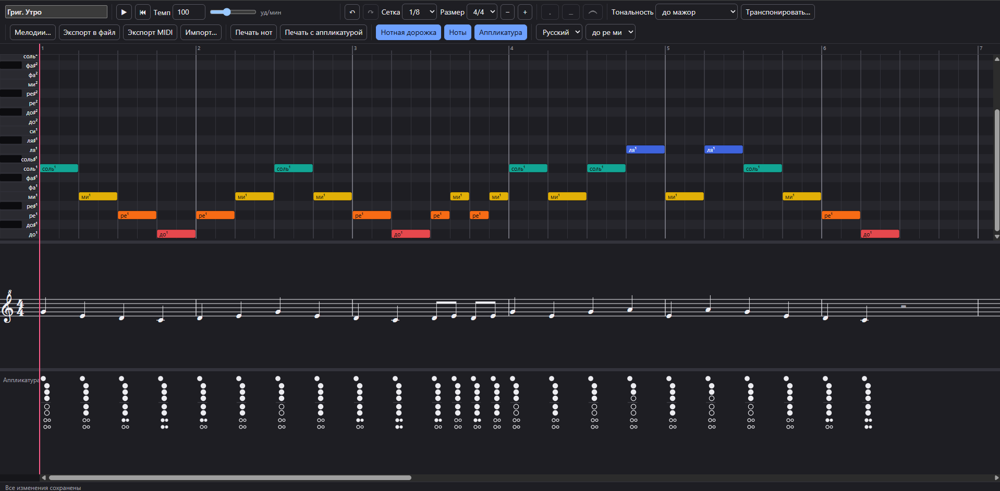

# Recorder Composer

A browser app for writing melodies for the soprano baroque recorder (C5–D7) and learning to play
them. Runs entirely in the browser — no server, no account.

**Try it: [sergeyvbo.github.io/RecorderComposer](https://sergeyvbo.github.io/RecorderComposer/)**



## Features

- **Timeline editor** — click to add notes, drag to move, drag edges to stretch, box/Ctrl/Shift
  selection, copy/cut/paste, undo/redo (200 steps), snap 1/4…1/32. Melodies are always single-voice
  and inside the recorder range: a dragged note jumps into free space or stops at its neighbour.
- **Sheet music** in treble clef (written an octave below sounding pitch, clef marked 8) and a
  **baroque fingering diagram under every note**, all on one shared, zoomable time axis. Hover a
  diagram for alternate fingerings. Panels are resizable and can be hidden.
- **Playback** with a recorder-like synthesized tone, tempo 30–240 BPM, one playhead across all
  panels, click the ruler to seek, Space to play/pause.
- **Auto-save** in the browser (IndexedDB) with a melody library (new, open, rename, duplicate,
  delete); export/import `.rcm.json` files; optional **MIDI export**.
- **Printing**: sheet music only, or with fingerings under each note (A4 / Letter).
- **Russian and English** interface; note names as **до ре ми / do re mi** or **C D E**, with
  octaves as до¹–ре³ (Russian) or C4–D6 (English).
- **Keys** with up to four sharps/flats, and transposition that reports notes leaving the range and
  offers the octave alternative.
- **Articulations**: staccato (`S`), tenuto (`T`) and legato slurs (`L` to apply, `Shift+L` to
  remove), from the toolbar or the keyboard. They are drawn in standard notation on screen and in
  print, marked on the timeline, heard on playback, and staccato is shortened in MIDI export.
- **Clear refusals**: whenever an action is impossible (nothing selected, no room, legato over a
  selection with gaps, nothing to undo…), a short message says why.

Fingerings (standard and alternates) are taken from Yamaha's
[soprano recorder (Baroque) fingering chart](https://www.yamaha.com/en/musical_instrument_guide/common/images/recorder/fingering_baroque.pdf).

## Commands

```sh
npm install
npm run dev          # http://localhost:5173
npm run build        # static bundle in dist/
npm run preview      # serve the built bundle

npm run typecheck    # tsc --noEmit
npm run lint         # ESLint (layering + no hard-coded UI strings)
npm test             # Vitest unit, property and component tests
npx playwright install   # once, downloads test browsers
npm run test:e2e     # Playwright end-to-end scenarios (quickstart.md)
npm run check        # typecheck + lint + test
```

Regenerate test fixtures with `node --experimental-strip-types scripts/make-fixtures.ts`.

Every push to `master` is checked and deployed to GitHub Pages by
[`.github/workflows/deploy-pages.yml`](.github/workflows/deploy-pages.yml).

## Architecture

`src/domain` (pure TypeScript music logic, no React/DOM) ← `src/state` (Zustand store, history) ←
`src/ui`, `src/audio` (Tone.js), `src/persistence` (IndexedDB, preferences) ← `src/bootstrap.ts` /
`src/main.tsx`. Lint rules enforce the layering. Design documents:
[`specs/001-recorder-composer/`](specs/001-recorder-composer/),
[`specs/002-note-articulations/`](specs/002-note-articulations/); project principles:
[`.specify/memory/constitution.md`](.specify/memory/constitution.md).

## Melody files

`.rcm.json` files follow
[`melody-file.schema.json`](specs/002-note-articulations/contracts/melody-file.schema.json)
(`formatVersion: 2`, which adds each note's optional `mark` and `slurNext`); the same document is
what is stored in the browser. Version 1 files still open, with every note plain.

## Licenses

Music glyphs: Bravura font, SIL Open Font License 1.1 (`public/fonts/OFL.txt`).
